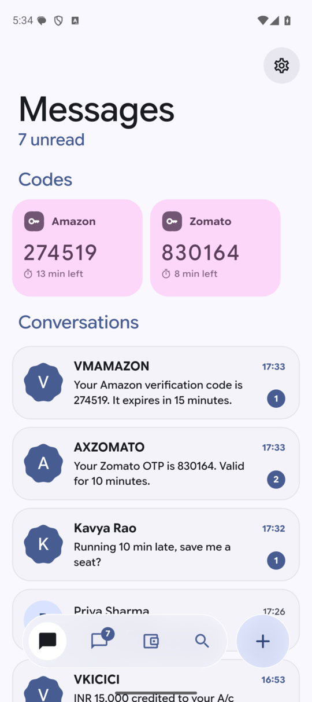
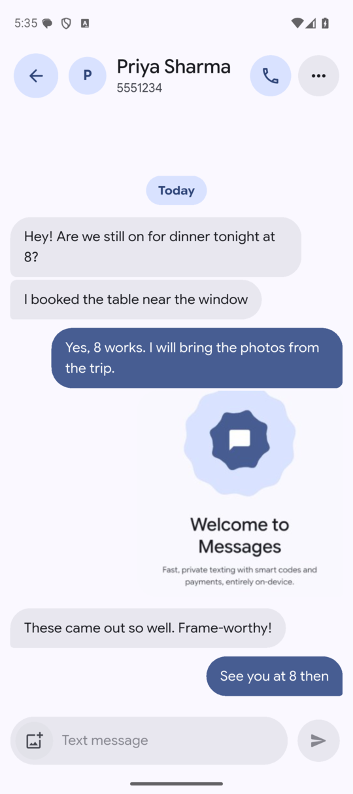
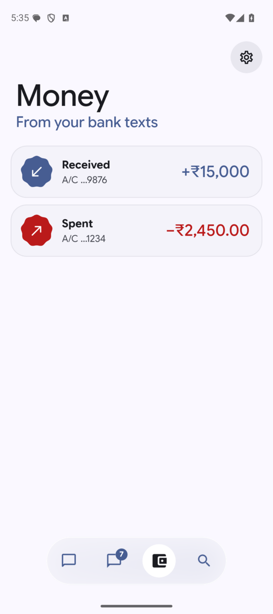
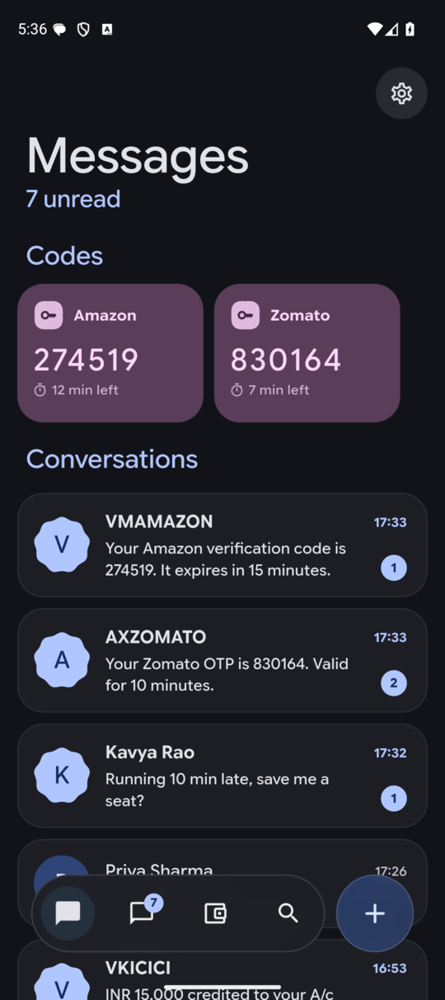
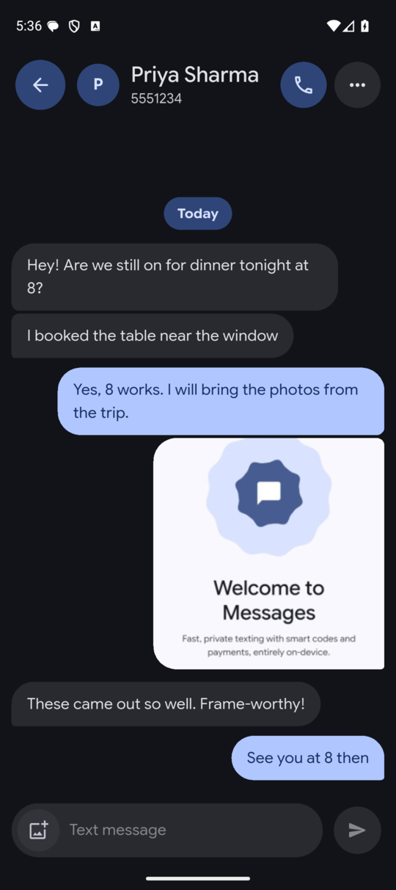
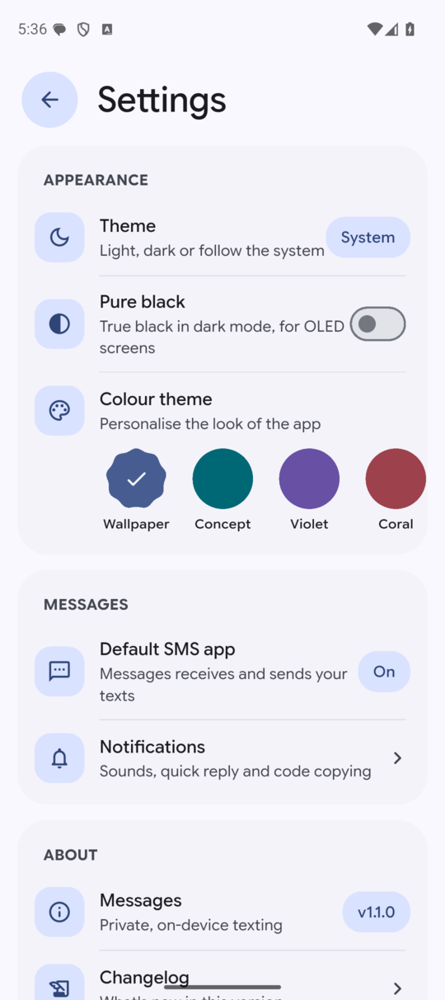
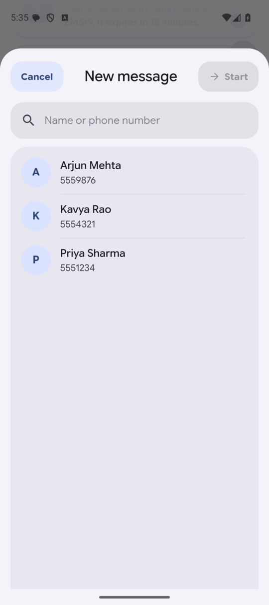
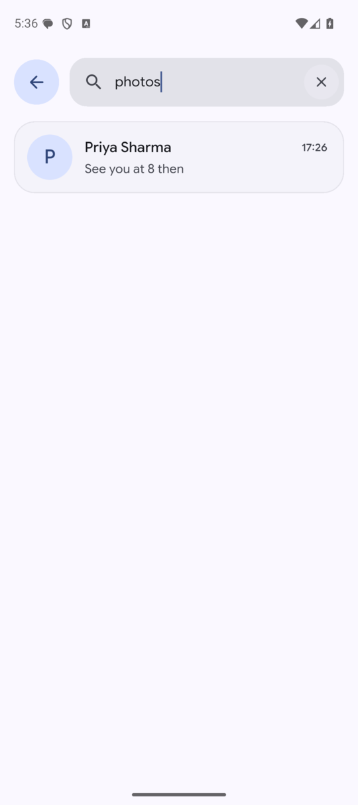
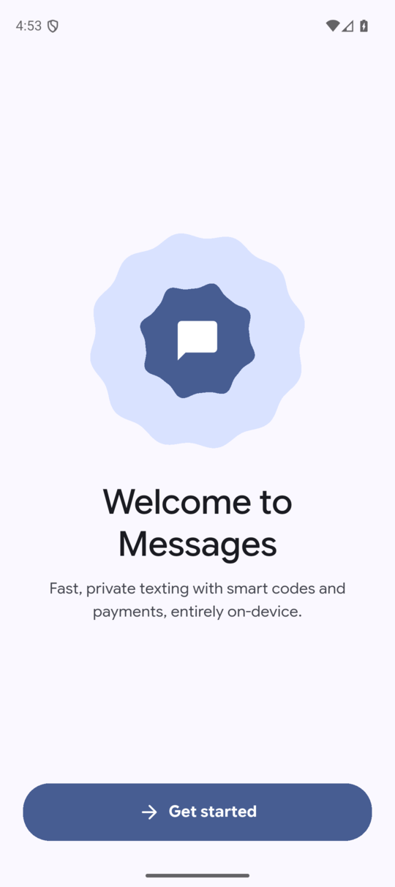
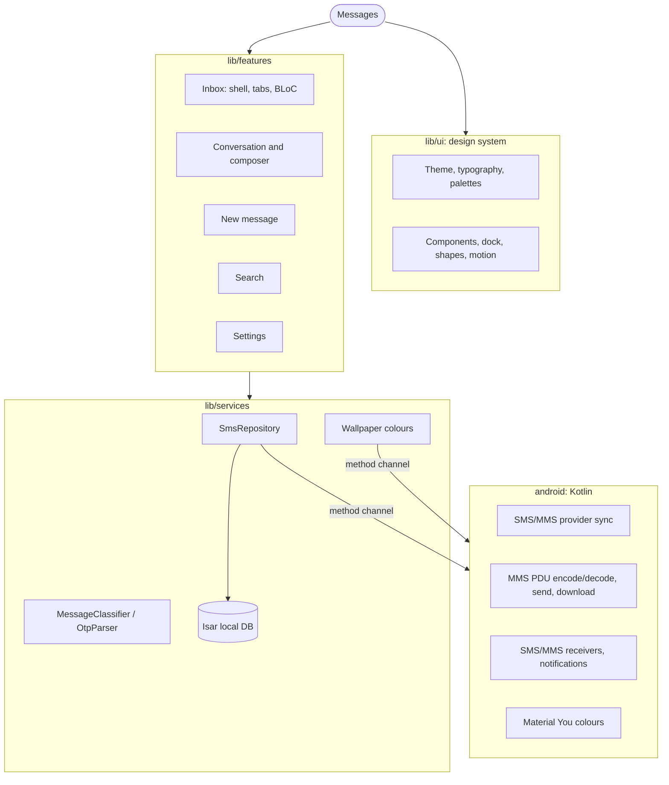

# Messages

[](https://dart.dev)
[](https://flutter.dev)
[](https://isar.dev)
[](https://bloclibrary.dev)

A fast, private SMS and MMS app for Android, built with Flutter in a Material 3 Expressive design.
Messages sorts your inbox on-device, surfaces one-time codes and bank transactions, and never
sends your messages anywhere.

> **Status:** in active development. SMS is complete; MMS (photo) sending and receiving is new
> and still being tested across carriers.

---

## Screenshots

<table>
  <tr>
    <td align="center"><br><b>Inbox and codes</b></td>
    <td align="center"><br><b>Conversation with photos</b></td>
    <td align="center"><br><b>Money</b></td>
  </tr>
  <tr>
    <td align="center"><br><b>Dark mode</b></td>
    <td align="center"><br><b>Conversation, dark</b></td>
    <td align="center"><br><b>Settings</b></td>
  </tr>
  <tr>
    <td align="center"><br><b>New message</b></td>
    <td align="center"><br><b>Search</b></td>
    <td align="center"><br><b>Welcome</b></td>
  </tr>
</table>

---

## Features

**Messaging**
- Full SMS client that can be set as the default SMS app, with conversation history, read state,
  swipe-to-delete and multi-select.
- MMS: attach up to three photos from the system photo picker. Images are compressed to your
  carrier's size limit. Incoming MMS are downloaded and stored when Messages is the default app.
- Delivery state on every outgoing message ("Sending", "Not sent").
- Notifications with inline quick reply and a one-tap "Copy OTP" action. A conversation's
  notification clears when you read it.
- Search across sender names, numbers and every message body.

**Smart inbox (all on-device)**
- **Codes:** active one-time passwords appear at the top of the inbox with the service name and
  time remaining, and disappear when they expire. Tap a code to copy it.
- **Money:** amounts, debits, credits and account endings are extracted from bank texts.
- **Unread:** a dedicated tab, with a count badge on the dock.
- Promotional senders (DLT IDs ending in `-P`) are kept out of notifications.

**Design**
- Material 3 Expressive: Google Sans Flex with optical sizing, expressive shapes, spring motion,
  and a floating glass navigation dock.
- Wallpaper colours on Android 12+, read natively from the system (exact system colour roles on
  Android 14+), or one of nine preset palettes.
- Light, dark and pure-black (OLED) themes, edge to edge.

---

## Architecture

The app follows a feature-driven structure, with a shared design system and a native Android
layer for everything the SMS and MMS providers require.



### Folder structure
- `lib/ui/`: the Material 3 Expressive design system (theme, typography, palettes, shapes,
  motion, glass, dock and shared components).
- `lib/features/`: screens and widgets, one folder per feature.
- `lib/services/`: the SMS repository, Isar models, message classification and wallpaper colours.
- `android/app/src/main/kotlin/`: SMS/MMS provider access, the MMS encoder and decoder,
  broadcast receivers and the Material You colour reader.
- `test/`: unit tests for the parsers and colour-scheme building.

---

## Tech stack

- **UI:** [Flutter](https://flutter.dev) 3.50 with [`material_ui`](https://pub.dev/packages/material_ui)
- **State management:** [flutter_bloc](https://pub.dev/packages/flutter_bloc) and [provider](https://pub.dev/packages/provider)
- **Local database:** [Isar Community](https://pub.dev/packages/isar_community)
- **Colour:** [material_color_utilities](https://pub.dev/packages/material_color_utilities) with a native Material You bridge
- **Android build:** Gradle 9.5, Android Gradle Plugin 9.3, Kotlin 2.4, JDK 17

---

## Getting started

### Prerequisites
- Flutter SDK 3.50 or newer
- JDK 17 or newer
- Android SDK, and an Android device or emulator

### Install and run

1. Clone the repository:
   ```bash
   git clone https://github.com/Najeer-k11/Messages-FlutterApp.git
   cd Messages-FlutterApp
   ```

2. Install dependencies:
   ```bash
   flutter pub get
   ```

3. Generate the Isar database code:
   ```bash
   dart run build_runner build --delete-conflicting-outputs
   ```

4. Run the app:
   ```bash
   flutter run
   ```

5. Run the tests:
   ```bash
   flutter test
   ```

> MMS needs a SIM with mobile data and MMS enabled by the carrier. Emulators can send and
> receive SMS but not MMS.

---

## Permissions and privacy

All message processing, classification and parsing happens on the device. No message content
or financial detail leaves it.

- **SMS:** read your messages, receive new ones and send replies.
- **Contacts:** show contact names instead of numbers, and pick recipients.
- **Notifications:** alert you to new messages, with quick reply and code copying.
- **Default SMS app (optional):** needed to receive messages in the background, store sent and
  received MMS, delete messages and keep read state in sync with the system.

Photos are chosen through the system photo picker, so the app never needs storage access.

---

## Credits

- Design system adapted from [Expressive Clock](https://github.com/samuelbeckman/expressive-clock)
  by Samuel Beckman, itself based on Material Clock by Rayane Bouafia (MIT). See
  [`licenses/LICENSE-MIT-material-clock.txt`](licenses/LICENSE-MIT-material-clock.txt).
- [Google Sans Flex](https://fonts.google.com/specimen/Google+Sans+Flex), SIL Open Font License 1.1.
  See [`licenses/OFL-1.1.txt`](licenses/OFL-1.1.txt).

---

## License

See the [LICENSE](LICENSE) file for details.
